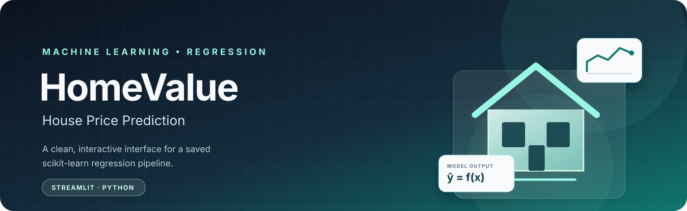
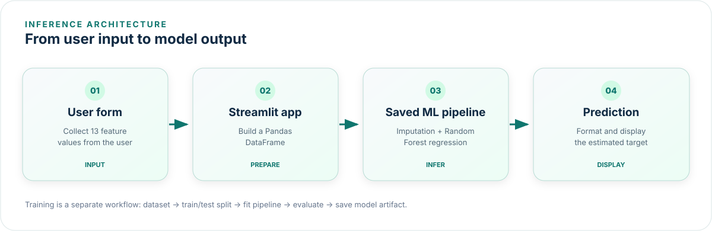

<br/>

# HomeValue

### A thoughtful machine-learning demo for estimating historical home values.

**From tabular data to an interactive prediction experience.**

<br/>

[](https://www.python.org/)
[](https://streamlit.io/)
[](https://scikit-learn.org/)
[](https://pandas.pydata.org/)
[](#project-status)

<br/>

**[Overview](#-overview) · [Features](#-features) · [How It
Works](#-how-it-works) · [Quick Start](#-quick-start) ·
[Deployment](#-deployment) ·
[Limitations](#-limitations--responsible-use)**


------------------------------------------------------------------------

## ◈ Overview

**HomeValue** is an interactive web application that demonstrates how a
trained machine-learning regression model can be presented through a
simple, user-friendly interface.

Users enter property and neighborhood characteristics, submit the form,
and receive an estimate generated by a **scikit-learn Random Forest
regression pipeline**. The interface is built with Streamlit, while
Pandas prepares the input data and Joblib loads the saved model
artifact.

> \[!IMPORTANT\] This is an **educational demonstration**, not a
> real-estate valuation product. It uses a historical Boston Housing
> dataset and does not estimate current market prices, evaluate a live
> address, or incorporate current listings or inflation adjustments.

## ✦ Project at a Glance

  -----------------------------------------------------------------------
  Area                                Implementation
  ----------------------------------- -----------------------------------
  Problem type                        Supervised learning · Regression

  Model                               Random Forest Regressor

  Data handling                       Pandas

  Missing-value handling              Scikit-learn `SimpleImputer` using
                                      the median

  Model pipeline                      Scikit-learn `Pipeline`

  Model persistence                   Joblib

  User interface                      Streamlit

  Prediction input                    13 tabular features

  Target                              `MEDV` --- historical target
                                      measured in thousands of US dollars

  Intended use                        Learning, experimentation, and
                                      demonstration
  -----------------------------------------------------------------------

## ✨ Features

-   **Interactive prediction form** --- collect property and
    neighborhood attributes through structured input controls.
-   **Saved-model inference** --- load the trained pipeline instead of
    retraining whenever a user makes a prediction.
-   **Consistent feature structure** --- arrange submitted values in the
    feature order stored with the model.
-   **Readable prediction result** --- display the model output with
    context about the dataset's units.
-   **Model pipeline** --- handle missing numeric values with median
    imputation before regression.
-   **Evaluation during training** --- report Mean Absolute Error (MAE)
    and the coefficient of determination (R²).
-   **Clear limitations** --- communicate that historical predictions
    are not current property valuations.

## ◈ Application Preview

The diagram below illustrates the intended user journey and the major
components. It is an architecture illustration, **not a screenshot of a
deployed application**.



### Prediction flow

1.  The user enters the 13 supported feature values.
2.  Streamlit collects the form values when **Estimate price** is
    submitted.
3.  The application constructs a one-row Pandas DataFrame.
4.  The saved scikit-learn pipeline processes the input and generates a
    prediction.
5.  The interface displays the estimate and an explanatory note.

## 🧠 How It Works

### 1. Training

`train_model.py` reads `boston_housing.csv`, separates the input
features (`X`) from the target (`y`), and creates a train/test split. A
scikit-learn pipeline combines median imputation with a
`RandomForestRegressor`.

The training script evaluates the held-out predictions with MAE and R²,
then saves a bundle containing the fitted pipeline, feature names, and
target name to `house_price_model.joblib`.

### 2. Inference

`app.py` loads the saved bundle and retrieves the fitted pipeline. When
the user submits the form, the application creates a DataFrame using the
stored feature order and calls `model.predict(...)`. The resulting value
is formatted for display.

**Training and inference are separate operations:** train the model when
you want to create or update the artifact; load the artifact to serve
predictions.

### 3. Model inputs

The application expects the following feature columns from the supplied
dataset:

  -----------------------------------------------------------------------
  Feature                             Description shown in the UI
  ----------------------------------- -----------------------------------
  `CRIM`                              Per-capita crime rate by town

  `ZN`                                Residential land zoned for lots
                                      over 25,000 sq. ft. (%)

  `INDUS`                             Non-retail business acres per town
                                      (%)

  `CHAS`                              Charles River tract indicator (0 or
                                      1)

  `NOX`                               Nitric oxides concentration

  `RM`                                Average rooms per dwelling

  `AGE`                               Proportion of owner-occupied units
                                      built before 1940

  `DIS`                               Weighted distance to employment
                                      centres

  `RAD`                               Highway accessibility index

  `TAX`                               Property tax rate

  `PTRATIO`                           Pupil-teacher ratio by town

  `B`                                 Historical dataset demographic
                                      index

  `LSTAT`                             Historical dataset variable
                                      describing lower-status population
                                      (%)
  -----------------------------------------------------------------------

Descriptions are simplified for readability. Refer to the dataset's
original documentation before interpreting variables scientifically. In
particular, `B` is a historically problematic demographic proxy and
should not be treated as an appropriate modern housing feature.

### 4. Evaluation

The training script prints:

-   **MAE (Mean Absolute Error):** the average absolute difference
    between observed and predicted target values on the test split.
-   **R²:** a measure of how much target variation is explained by the
    model on the test split.

The script calculates these metrics when it runs. Add the actual output
from your own run to this README if you want to report numeric
performance; do not copy or invent scores.

## 🗂️ Repository Structure

``` text
HomeValue/
├── app.py                    # Streamlit UI and prediction flow
├── train_model.py            # Training, evaluation, and model export
├── boston_housing.csv        # Supplied historical teaching dataset
├── house_price_model.joblib  # Saved trained pipeline (generated by training)
├── requirements.txt          # Python dependencies
├── README.md                 # Project documentation
├── .gitignore                # Files excluded from version control
└── assets/
    ├── homevalue-banner.svg
    └── homevalue-architecture.svg
```

The `.joblib` model file is generated by `train_model.py`. If you choose
not to commit model artifacts, change the deployment workflow so the
model is built or retrieved safely during deployment. The current
application expects the saved model to exist when it starts.

## 🚀 Quick Start

### Prerequisites

-   Windows with PowerShell, macOS, or Linux
-   A supported Python installation
-   Git (recommended for version control)

### 1. Clone your repository

Replace the placeholder with your own repository URL:

``` bash
git clone <your-repository-url>
cd <your-repository-folder>
```

If you already have the project on your computer, open a terminal in the
folder containing `app.py`.

### 2. Create a virtual environment

**Windows PowerShell**

``` powershell
py -m venv .venv
.\.venv\Scripts\Activate.ps1
```

If the `py` launcher is unavailable, try:

``` powershell
python -m venv .venv
.\.venv\Scripts\Activate.ps1
```

**macOS / Linux**

``` bash
python3 -m venv .venv
source .venv/bin/activate
```

### 3. Install dependencies

``` bash
python -m pip install --upgrade pip
python -m pip install -r requirements.txt
```

### 4. Train and save the model

``` bash
python train_model.py
```

This command reads the dataset, trains the pipeline, prints the
evaluation metrics, and creates `house_price_model.joblib` in the
project directory.

### 5. Launch the application

``` bash
python -m streamlit run app.py
```

Streamlit prints a local URL, usually `http://localhost:8501`. Open it
in your browser, enter the form values, and select **Estimate price**.

### 6. Stop the application

Return to the terminal and press `Ctrl + C`.

## ☁️ Deployment --- Streamlit Community Cloud

This project can be deployed using [Streamlit Community
Cloud](https://share.streamlit.io/).

### Before deployment

-   [ ] Confirm the app runs locally.
-   [ ] Confirm `train_model.py` completes without errors.
-   [ ] Confirm `house_price_model.joblib` is created.
-   [ ] Confirm `requirements.txt` contains all runtime dependencies.
-   [ ] Confirm `app.py` and the saved model use compatible feature
    names and versions.
-   [ ] Confirm the repository does not contain secrets, local virtual
    environments, or unnecessary files.

### Deployment steps

1.  Push the project to a GitHub repository.
2.  Ensure the repository contains `app.py`, `train_model.py`,
    `requirements.txt`, `boston_housing.csv`, `README.md`, and the
    generated `house_price_model.joblib` model artifact.
3.  Open [Streamlit Community Cloud](https://share.streamlit.io/) and
    sign in with GitHub.
4.  Create an app, select the repository and branch, and set `app.py` as
    the main file.
5.  Deploy and wait for the build to finish.
6.  Open the public app URL and test a prediction.

### Common deployment issues

  ------------------------------------------------------------------------
  Symptom                             What to check
  ----------------------------------- ------------------------------------
  Model file missing                  Verify `house_price_model.joblib`
                                      exists in the deployed repository or
                                      change the app to create/retrieve it
                                      during startup.

  Module not found                    Add the missing runtime dependency
                                      to `requirements.txt`, then
                                      redeploy.

  File not found                      Use paths relative to
                                      `Path(__file__).resolve().parent`,
                                      and confirm required files are
                                      committed.

  Prediction error                    Confirm the input columns and their
                                      order match the features used during
                                      training.

  Different behavior locally and      Compare Python/library versions and
  online                              rebuild the model in the deployment
                                      environment if compatibility
                                      requires it.

  App fails during startup            Open the deployment logs and read
                                      the first actionable traceback
                                      rather than guessing.
  ------------------------------------------------------------------------

For more information, consult the [Streamlit deployment
documentation](https://docs.streamlit.io/deploy/streamlit-community-cloud).

## 🧪 Testing Checklist

Before sharing the project, test the following:

-   [ ] The training script runs from a clean virtual environment.
-   [ ] The model artifact is created at the expected path.
-   [ ] The app starts without errors.
-   [ ] The form accepts valid values and returns a prediction.
-   [ ] Numeric inputs respect the configured ranges.
-   [ ] The prediction is finite and formatted as expected.
-   [ ] The UI explains the target units and limitations.
-   [ ] Missing model/data files produce understandable errors.
-   [ ] The deployed app works in a fresh browser session.
-   [ ] The README setup steps work from a clean checkout.

## 🔐 Reproducibility & Project Hygiene

-   Use a virtual environment to isolate dependencies.
-   Keep dependency versions under review and test upgrades before
    deployment.
-   Re-train and evaluate the model when the dataset or training
    procedure changes.
-   Keep training data, feature order, and preprocessing consistent with
    the saved pipeline.
-   Never commit API keys, passwords, tokens, or private credentials.
-   Keep `.venv/`, Python cache files, and local secret files out of
    Git.
-   Review dataset licensing, provenance, and usage limitations before
    redistribution.

## ⚖️ Limitations & Responsible Use

This project is designed for **learning and demonstration only**.

-   **Historical data:** The supplied Boston Housing dataset reflects a
    historical context and is not a source of present-day real-estate
    prices.
-   **No live market information:** The app does not look up addresses,
    current listings, interest rates, renovations, or current local
    conditions.
-   **Dataset limitations:** The dataset is widely known to have ethical
    and representativeness concerns. Its variables and historical
    collection context should be examined critically.
-   **Sensitive proxy feature:** The original `B` variable encodes a
    historical demographic measure tied to race. Its inclusion can
    encode harmful assumptions and makes this dataset unsuitable as a
    template for responsible modern housing decisions.
-   **No decision-making use:** Do not use this model to set a sale
    price, make lending decisions, assess a person or neighborhood, or
    make financial or legal decisions.
-   **Model performance is not universal:** Metrics from one random
    train/test split do not prove that predictions generalize to other
    locations or time periods.

A responsible next iteration would use a more recent, documented dataset
with appropriate feature selection, stronger evaluation, and a clearly
defined intended use.

## 🛣️ Roadmap

Potential improvements for future versions:

-   [ ] Add a screenshot of the actual running interface.
-   [ ] Add a model evaluation section populated with real training
    output.
-   [ ] Add automated tests for input validation and prediction
    behavior.
-   [ ] Add feature-importance analysis with appropriate caveats.
-   [ ] Improve accessibility and small-screen layout.
-   [ ] Explore a more recent, ethically reviewed housing dataset.
-   [ ] Optionally separate a custom frontend from the inference service
    using React and FastAPI.

These are ideas for future work, not claims that the current version
already implements them.

## 🧰 Technology Stack

  -------------------------------------------------------------------------------
  Technology                                  Role
  ------------------------------------------- -----------------------------------
  [Python](https://www.python.org/)           Application and training language

  [Streamlit](https://streamlit.io/)          Interactive web interface

  [Pandas](https://pandas.pydata.org/)        Tabular data handling

  [scikit-learn](https://scikit-learn.org/)   Preprocessing pipeline, Random
                                              Forest model, and evaluation

  [Joblib](https://joblib.readthedocs.io/)    Saving and loading the fitted model

  [GitHub](https://github.com/)               Source control and project hosting

  [Streamlit Community                        Application deployment
  Cloud](https://share.streamlit.io/)         
  -------------------------------------------------------------------------------

## 🤝 Contributing

This is currently a learning project. Suggestions and improvements are
welcome.

1.  Fork the repository.
2.  Create a focused branch for your change.
3.  Make and test your changes.
4.  Open a pull request describing the motivation and validation
    performed.

For substantial changes, open an issue first to discuss the proposed
approach.

## 📄 License

No license has been specified in the supplied project files. Add a
`LICENSE` file before presenting the project as open source or granting
reuse rights. Do not assume that the dataset and application code have
identical licensing terms.

------------------------------------------------------------------------

::: {align="center"}
**HomeValue** · A learning project in applied machine learning

*Built to explore the path from a trained model to an interactive
application.*
:::
